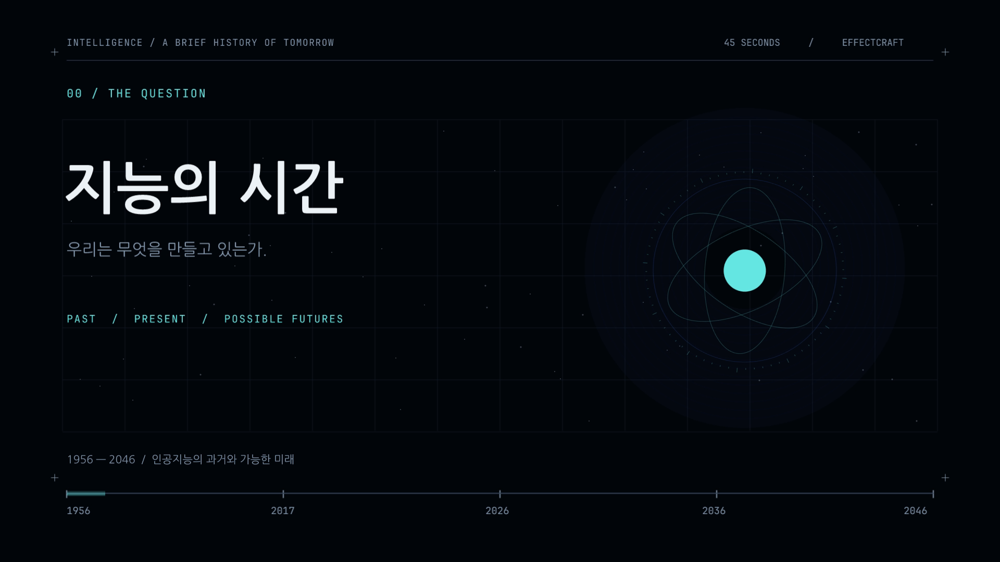

# 지능의 시간 — 45초 모션그래픽

EffectCraft로 제작한 AI의 과거·현재·가능한 미래. 1920×1080, 24fps, 한국어 타이포그래피와 오리지널 음악. 내레이션은 없습니다.

## 다운로드

- **[완성 영상 MP4 다운로드](./Intelligence-45s-1080p.mp4?raw=true)** — 약 56MB
- **[편집 프로젝트·음악·글꼴 ZIP 다운로드](./Intelligence-45s-EffectCraft.zip?raw=true)** — 약 11MB
- [분석 근거와 출처](./SOURCES.md)
- [품질 검사 결과](./QUALITY.md)

영상 파일 화면에서 미리보기가 나오지 않으면 **Download raw file** 또는 **Raw**를 선택하세요. 비공개 저장소라면 GitHub 로그인이 필요합니다.

## 내용과 검증

1956년 AI 연구의 출발부터 학습·대화형 AI·추론의 발전을 거쳐, 2036년과 2046년의 조건부 시나리오를 담았습니다. 최근 변화의 직접 확인 자료는 2024–2025년 중심이며, 2026년 최신 현황 전수 조사로 제시하지 않았습니다.

영상 45.000초 / 1080프레임, H.264 + 48kHz AAC 스테레오. 전체 디코딩 검사와 프로젝트 ZIP 복원 검사를 통과했습니다.

이 브랜치는 완성 결과물을 전달하는 전용 브랜치입니다. 앱 소스 변경이나 main 브랜치 병합은 포함하지 않습니다.

## 편집

ZIP을 풀어 동봉된 Fonts의 글꼴을 설치한 뒤 EffectCraft 0.13.0으로 `.ecproj`를 여세요. 음악·글꼴·제작 스크립트·사용법이 포함돼 있습니다.

## 권리

원본 영상·벡터 디자인·전자음악·문서는 MIT OR Apache-2.0. ZIP에 포함된 글꼴은 각각 SIL Open Font License 1.1을 따르며 라이선스와 출처가 동봉돼 있습니다. `ATTRIBUTION.md`와 각 `.attribution` 파일을 확인하세요.
